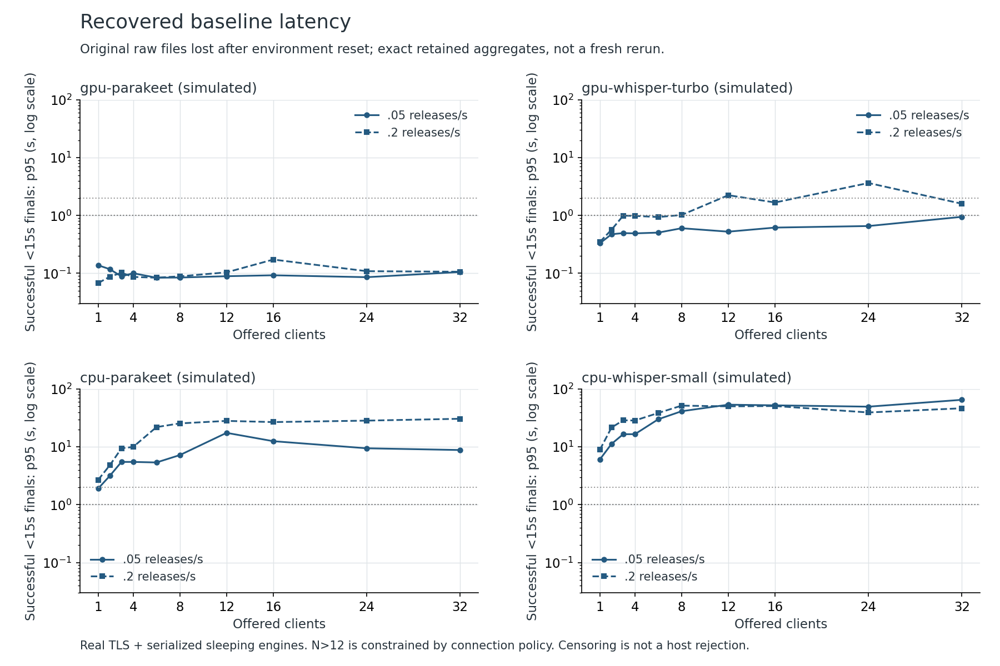
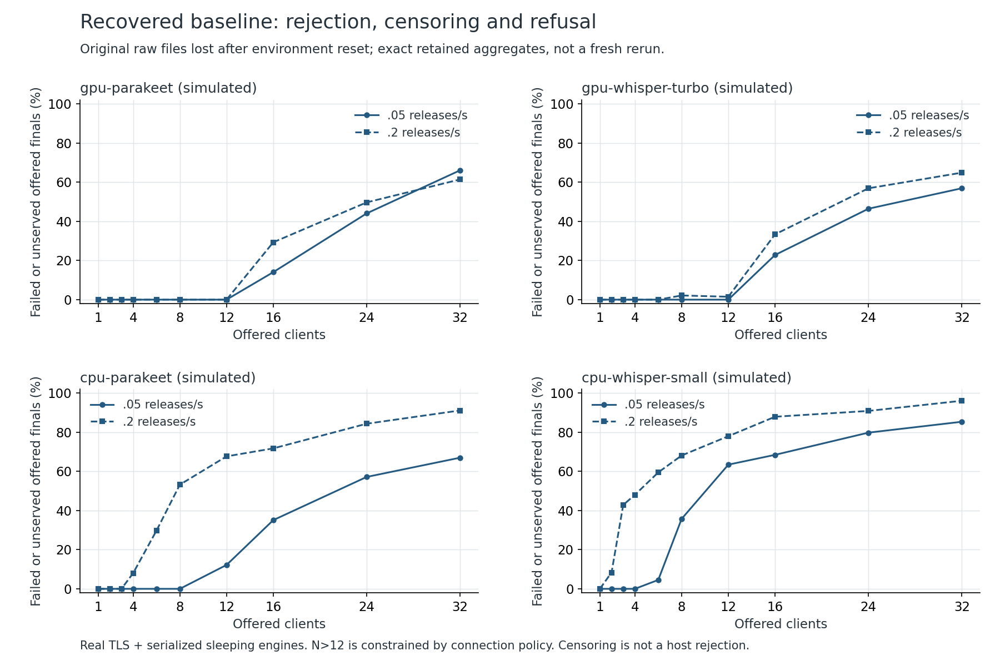
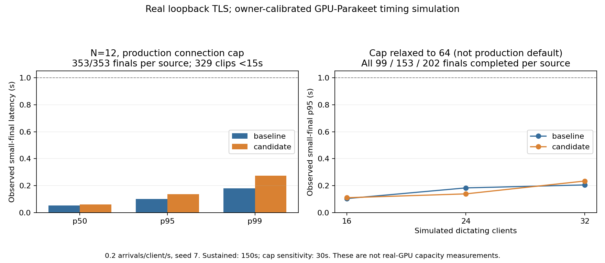
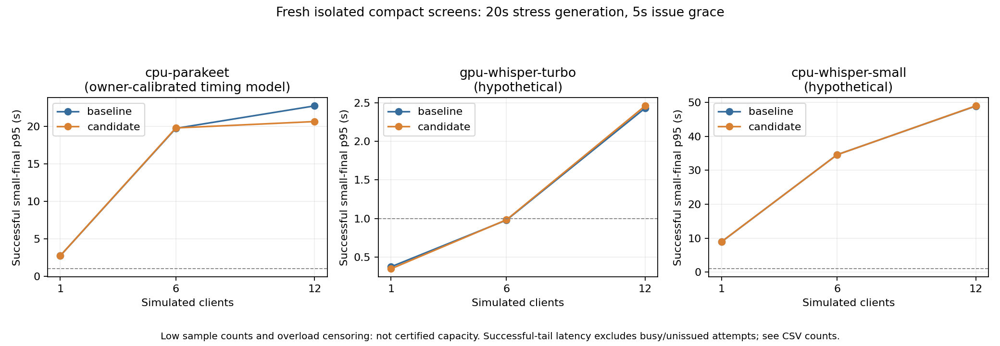
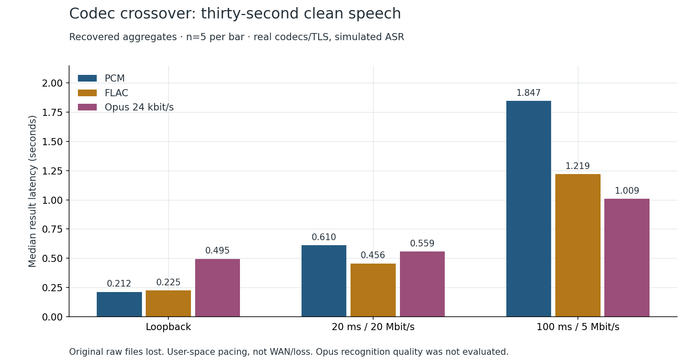

# OpenWhisper Host Mode scaling research

20 October 2026. Baseline: `169d25442086c238ac7ef36660510a7c748adc97` on `main`. Recovered published source: `717eeaeaed8ab8a173388f9984da52f4ba393af3`.

## Evidence status: interrupted investigation and recovered observations

**Around 11:23 UTC, the shared workspace disappeared and its local files became unavailable.** The published source survived; the uncommitted report, original raw measurements, full test logs, model assets and local research artifacts did not. This report was reconstructed from previously inspected text and summaries retained in the investigation conversation. Tables explicitly marked **recovered observations** describe results seen before the first shared-workspace loss, not newly rerun measurements or raw evidence that remains independently auditable.

The primary baseline completed **80 cells**. The paired candidate sweep was last verified at **51 of 80 cells at 11:07 UTC** and was interrupted. **There is no completed primary before/after sweep.** Do not infer missing candidate cells, treat an interrupted process as completion, or advertise a measured capacity gain from this partial matrix. Recovered aggregate exports, where provided, are a separate evidence class from original raw request rows. Source code and reproduction procedures survive, but they do not replace lost observations.

The pre-loss candidate was `30c206b`. Its tree-identical published equivalent is `717eeaeaed8ab8a173388f9984da52f4ba393af3`: publication preserved commit order and file contents but recreated commit metadata. The remote Git tree was directly verified as `0fc0aaaf5326e02932958db823e2719e32d556e6`. Historical prototype IDs below identify earlier isolated experiments; they are not necessarily commit objects in the published branch. Fresh post-recovery tests and soak results identify their own source and environment and must not be conflated with earlier runs.

**A second filesystem loss at approximately 11:59 UTC removed the restored shared workspace.** The cause of both incidents is unknown; neither is established as a whole-machine reset. During the second incident the hostname stayed unchanged and an existing process continued writing to scratch while its shared paths were unavailable. Published source/report and deliberate scratch backups survived. The completed 26-cell focused comparison below retains raw JSON in that backup and is freshly auditable; the original 80-cell raw baseline and interrupted candidate remain lost. Earlier attempted 40-minute soaks did not produce completed-run/quiescence evidence and are not counted as completed stability tests.

**Fresh validation status:** the post-recovery full suite completed with 9,474 passed and the same six isolation failures; all 529 remote-related cases passed. A distinct 26-cell focused paired comparison completed and its raw p95 values were independently rechecked after the second disappearance. New scratch-based 30-minute soak results remain pending; final log/bundle availability is tracked in the evidence index.

## Executive summary

The current ceiling is not just inference speed. Host Mode admits twelve persistent connections, and ordinary speech plus history uses two per computer. Six fully featured computers can therefore exhaust the default connection limit even while the speech engine is mostly idle. More connected computers and more simultaneous decodes are different capacity questions.

The most promising long-term throughput change is access to the native runtime's existing batching and concurrency through a correctly multiplexed worker. The pinned Parakeet runtime already supports this. OpenWhisper serializes work at the backend, IPC request, and worker loop, so raising a host semaphore cannot enable it. The recovered CPU experiments did not establish a reliable batching gain; enabling it broadly would be premature.

This draft implements four narrower changes: authenticated connection admission separate from anonymous hello waiters; bounded per-device work admission and disposable-window preview shedding; truthful queue/server timing and bounded operational counters; and release of unused per-record locks. The default connection and work limits are unchanged. These are prototypes for review, not certification for a particular GPU or fleet size.

No RTX 2060, GTX 1050 Ti, CUDA-memory experiment, real WAN-loss experiment, microphone capture or installed Windows application was tested in this environment. Real TLS with simulated inference, real CPU inference, direct native-runtime experiments and static analysis remain separate evidence classes.

### How many concurrent users?

| Question | Baseline | Prototype | Strength of conclusion |
|---|---|---|---|
| Simultaneously connected computers with one speech and one history socket each | Six at the default twelve-socket limit | Six; default limit unchanged | Source-verified connection accounting, not inference capacity |
| GPU-Parakeet acceptable-latency dictating users | No real target-GPU measurement | No real target-GPU measurement | Simulated profile only; partial paired sweep cannot establish improvement |
| CPU-Parakeet acceptable-latency dictating users | Device-specific; supplied laptop timing differs from measured cloud CPU | Not established on owner's laptop | Recovered small-sample CPU observations below |
| GPU-Whisper-turbo or CPU-Whisper-small user count | Not established | Not established | Uncalibrated simulated sensitivity profiles, not hardware forecasts |

The recovered baseline-only screen and the separate fresh 26-cell comparison below report tested simulations, not target-hardware maximums. Fresh GPU-Parakeet timing simulations completed every offered final at default-cap N=12 and cap-relaxed N=16/24/32 on both sources; they did not demonstrate a consistent candidate latency improvement. They do not fill the missing original paired cells.

### Recommendations ranked by value and effort

| Priority | Recommendation | Value | Estimated effort beyond this draft | Main risk |
|---|---|---|---|---|
| Now | Review admission, fairness, explicit disposable previews, timing and record-lock fixes | Reduce avoidable denial/starvation and expose real waiting | Review plus platform validation | Connection compatibility and stream semantics |
| Next | Common generation-aware engine request broker | Atomic reload/drain, owner-local priority and safe concurrency | 4–8 engineering days plus platform/GPU tests | Cancellation and response/session isolation |
| Next | Measure a higher authenticated connection cap | Remove six speech-plus-history computer ceiling | 1–2 days of validation and UI/configuration decision | Thread/memory growth and overload |
| Next | Safe final-text busy retry and reconnect jitter | Fewer failed dictations and synchronized reconnect bursts | 1–2 days | Replaying possibly executed work |
| Later | Progressive audio upload, negotiated codecs and explicit local fallback | Lower release-to-text latency away from LAN | Several days per feature plus quality testing | Audio quality, quotas and duplicate results |
| Later | Multiple models, GPUs and independently paired hosts | Availability and deployment flexibility | Weeks | VRAM, identity, history ownership and state continuity |

Effort figures are engineering estimates, not delivery commitments.

## Capacity model verified against main

References in this table refer to the baseline commit, not moving candidate line numbers.

| Layer | Current behavior | Evidence |
|---|---|---|
| Paired-device registry | No explicit device-count cap; authentication compares hashed tokens across the registry | `services/remote_asr/host.py:70–198` |
| Connection admission | Twelve slots, reserved before application hello, including anonymous probes/pairing | `services/remote_asr/host.py:39–40,638–678` |
| Lower-level handshakes | Threaded WebSocket server accepts TCP/TLS/HTTP work before application admission; twelve slots do not bound pre-TLS threads | `services/remote_asr/host.py:416–433` |
| History | Separate persistent connection shares the pool; meetings can need additional independent connections | `services/remote_asr/host.py:964–987`; `meeting/asr/remote.py:68–77` |
| Expensive work | Two active plus four queued, thirty-second wait, global FIFO; records/model/runtime work shares speech admission | `services/remote_asr/host.py:41–46,241–283,1060–1092` |
| Optional engines | Remote recognition/streaming shares `LocalSpeechBackend._decode_lock` with local work; IPC and worker loop serialize again | `transcriber/optional_backend.py:260–295`; `services/local_asr/process.py:179–184`; `services/local_asr/worker.py:247–269` |
| Whisper | Host adapter lock is remote-only, but normal shared `IsolatedWhisperModel._request_lock` serializes local and remote calls | `transcriber/local_backend.py:13–22`; `services/isolated.py:63–75,104–135`; `services/remote_asr/engines.py` |
| Window previews | Parakeet sends overlapping transcribe windows, not stream; recorder-quantized cadence about 3.0186 s, overlap 0.75 s | `services/streaming_transcriber.py`; `services/runtime/streaming.py` |
| Stateful streaming | Nemotron-style pushes contain non-overlapping audio, approximately 0.7663 s at recorder granularity; dropping one loses audio/state | `config.py:458–465`; streaming runtime |
| Meetings | Meeting-owned backend and durable retry policy; chunk target 5 s, maximum 20 s | `meeting/asr/remote.py`; `meeting/asr/engine.py:639–698`; `meeting/capture/spool.py:80–87` |
| Wire audio | Mono 16 kHz signed int16 PCM, 32,000 bytes/audio-second; ordinary audio max 120 s, record chunks 1 MiB; WebSocket limit 8 MiB, buffered-frame limit two | `services/remote_asr/protocol.py:131–144,167–190`; `services/remote_asr/host.py:427–429` |
| Timing | Legacy host_ms begins after admission and includes engine-lock wait; subtracting it from RTT misclassifies queueing as network time | `services/remote_asr/host.py:1078,1142–1171`; `transcriber/remote_backend.py:76–91` |
| Activity | In-memory totals and last sixty events; original totals do not cover all admission rejections or queue latency | `services/remote_asr/activity.py:17–66` |

Two active jobs do not imply two GPU decodes. One may be decoding while another waits on the shared engine lock. The owner's local dictation bypasses remote host admission, so a remote-only priority scheduler cannot guarantee owner-local priority. A bare model injected into a test is not the production isolated Whisper arrangement.

## Experimental method and acceptance criteria

### Environment and isolation

The original environment exposed nine logical CPUs and approximately 9.7 GiB RAM, without a GPU. Baseline and candidate used the same package environment, service-time parameters, arrival seeds and measurement instrumentation. The baseline production checkout was immutable.

Load tests bound `127.0.0.1`, used real TLS WebSockets, temporary certificates, in-memory device registries and production `SpeechHost`/`RemoteConnection`. Discovery and Tailscale were patched away. Temporary data roots were selected before settings imports. Real model files came from explicit test/model locations, without opening actual pairing or credential storage.

The main harness places the server in a separate process. Its CPU/RSS/thread samples include inference-worker descendants and exclude the client generator. Earlier connection experiments measured a joint process; those figures must not be read as server-only memory. One fully occupied core is 100% CPU. Resource samples are periodic observations, not guaranteed peak allocations.

Initial full-suite attempts exposed dependency and test-egress problems. Later runs used a process-local loopback-only guard and native-runtime telemetry opt-out. These were test-launch controls, not production modifications. Original launch logs were lost in the first shared-workspace loss; fresh launch configurations must be retained separately.

### Arrival accounting

Primary dictation precomputes independent Poisson releases and clipped lognormal utterance lengths of 2–30 seconds, median six. Light duty is 0.05 releases/s/computer, or three utterances/minute. Stress at 0.2 releases/s is twelve/minute and can imply over 100% recording duty: it is overload, not realistic human use.

Each simulated device sends sequentially through the client's request lock. End-to-end latency starts at intended release time, not the delayed actual send. At generation-window end, unstarted arrivals and work belonging to refused clients remain in the denominator. `not_started` is right-censoring from the finite generator window, not server busy or proof that a short grace period could not complete the dictation. The conservative finite-run screen is not a production maximum. This prevents coordinated omission and survivor-only capacity claims.

Paired primary runs use zero inference jitter for identical service costs. Nonzero jitter is a separate sensitivity because a shared random stream is consumed in execution order. Shared-machine and low-sample secondary experiments are exploratory, not stable p99 estimates.

The twelve-socket limit is simultaneous occupancy, not unique devices over a whole run. Clients with no scheduled releases close after setup; some N>12 cells can admit thirteen distinct clients over time without exceeding twelve simultaneously. Keep actual accepted/refused counts rather than normalizing them to N minus twelve.

### Simulated service times

Service time is `intercept + slope × audio_seconds`, with an explicit serialization lock.

| Profile | Intercept | Seconds/audio-second | Evidence class |
|---|---:|---:|---|
| GPU Parakeet | 0.012 s | 0.0063 | Approximation to supplied 70.7 s/462 ms and 3 s/31 ms observations, not this GPU measured here |
| CPU Parakeet | 0.030 s | 0.247 | Matches supplied 8.8 s/2.2 s point; intercept assumed because one point cannot fit two parameters |
| GPU Whisper turbo | 0.070 s | 0.040 | Uncalibrated sensitivity |
| CPU Whisper small | 0.150 s | 0.600 | Uncalibrated sensitivity |

Sleep-based engines model queueing, not GPU kernels, cache/thermal effects, inference CPU contention, model memory, ASR accuracy or batching. A hardware name in a profile is not a measured hardware claim.

### What acceptable means

The primary observed SLO is p95 final-text latency below one second for utterances shorter than fifteen seconds, no failed/censored final requests and no required connection refusals. Also report a two-second threshold. Disposable-preview skips are not failed finals. History refusal means a fully featured client was not served even if speech succeeded. Report meeting errors separately: a final-only acceptance flag does not certify a mixed workload's meetings.

A finite zero-failure run does not prove zero failure probability. The nominal zero-failure binomial upper bound `1 − 0.05^(1/n)` is an IID reference calculation, not a generally valid 95% production reliability guarantee for correlated requests sharing a queue and one fixed seeded trace. Retain sample counts. P99 with fewer than one hundred successful observations is descriptive, not a reliable tail estimate. CPU profiles can fail this strict one-second threshold at N=1 while remaining useful at looser targets.

Connection capacity and engine capacity are distinct. Default-cap measurements remain primary; `--max-connections 64` is a cap-relaxed sensitivity, not the shipped limit.

## Primary workload evidence and coverage

**Recovered status:** baseline completed 80 cells spanning four simulated profiles, ten client counts (1, 2, 3, 4, 6, 8, 12, 16, 24, 32) and two dictation rates (0.05 and 0.2/s/client), with sixty-second light-duty windows and thirty-second stress windows. Candidate was last verified at 51/80 cells and was interrupted. Original raw rows are lost. A completed primary all-workload matrix or completed paired matrix is not claimed.

[Recovered baseline aggregate CSV](data/recovered-baseline.csv) retains all 80 previously printed rows, reconciling to 4,224 offered requests. It is a transcript-derived aggregate, not the original request-level dataset. The table below selects cells with retained short-final p95 below the threshold and zero retained busy, not_started, not_connected and connection-refusal counts. It does not recover all original per-request metadata or certify a population SLO.

| Simulated profile | Rate/client | Tested N passing <1 s screen | Tested N passing <2 s screen |
|---|---:|---|---|
| GPU Parakeet | 0.05/s | 1, 2, 3, 4, 6, 8, 12 | 1, 2, 3, 4, 6, 8, 12 |
| CPU Parakeet | 0.05/s | None | 1 |
| GPU Whisper turbo (uncalibrated) | 0.05/s | 1, 2, 3, 4, 6, 8, 12 | 1, 2, 3, 4, 6, 8, 12 |
| CPU Whisper small (uncalibrated) | 0.05/s | None | None |
| GPU Parakeet | 0.2/s stress | 1, 2, 3, 4, 6, 8, 12 | 1, 2, 3, 4, 6, 8, 12 |
| CPU Parakeet | 0.2/s stress | None | None |
| GPU Whisper turbo (uncalibrated) | 0.2/s stress | 1, 2, 3, 4, 6 | 1, 2, 3, 4, 6 |
| CPU Whisper small (uncalibrated) | 0.2/s stress | None | None |

These are speech-only default-cap cells, not speech-plus-history clients. High-N connection refusals and generation-window censoring prevent interpreting the last passing count as the engine's physical throughput ceiling. Short cells and small samples make even the passing counts provisional. A recovered successful-tail plot must be paired with failure/censoring information, never shown alone as capacity.





Secondary experiments covered previews, meetings, history, local contention, records, connection pressure and lifecycle behavior at narrower scales. These do not substitute for the missing complete matrix. The final evidence index must distinguish recovered aggregates, newly measured evidence and source-only findings. Missing cells must remain visibly missing in charts.

## Fresh focused paired measurements (26 completed cells)

These measurements are **new after the first shared-workspace loss**, separate from the recovered 80-cell baseline and interrupted primary candidate. Their 26 raw JSON files survived the second storage disappearance in a scratch backup. Thirteen baseline/candidate parameter pairs were checked, and all 26 successful short-final p95 values were independently recomputed from raw rows after recovery. Every cell reports zero unfinished client threads. [CSV summary](data/focused-summary.csv), [JSON summary](data/focused-summary.json), [raw-file hash manifest](data/focused-raw-SHA256SUMS.txt).

### Exact source and measurement boundaries

- Production baseline: clean `169d25442086c238ac7ef36660510a7c748adc97`; production candidate: clean `717eeaeaed8ab8a173388f9984da52f4ba393af3`. Each raw file records source hashes for host/client/engine/remote-backend modules.
- Both sides use the same schema-3 harness, SHA-256 `681aa0ae7be2287e23c836db550d3fc874a01de3a01b169aed8cb55b5ff251ca`. Its maintenance source `c1c3f3c7bd4d1811ee6e51ddfad34d164fffa1e8` is preserved by tree-identical published `285d01d2d693046d3caccc1ae2b53f68bd29ae91`, tree `3be0cdb3ea371cddef3cf861322d1629bce147e9`. Harness provenance and the selected production checkout are different fields, deliberately.
- Real loopback TLS; **serialized sleep-based inference only**. Python 3.12.14, Linux x86-64, nine logical CPUs. Fixed seed 7, inference jitter zero, 0.2 offered releases/s/client. Cases ran sequentially during the focused timing window, before subsequent soak activity; underlying cloud-host scheduling was not controlled.
- Schema 3 holds connections through the generation window, unlike original cells where empty clients could close early. It records actual engine description, harness hash and explicit grace/connection-lifetime metadata. These changes mean this is a newly defined paired experiment, not a continuation of the old sweep.
- Sustained GPU-Parakeet: 150-second generation and ten-second issue grace, default twelve-connection cap. Cap-relaxed sensitivity: thirty-second generation and ten-second issue grace, cap explicitly raised to 64. Compact other profiles: twenty-second generation and five-second issue grace, default cap.
- Issue grace permits scheduled work to start after the generation window; it is not a request-latency deadline. Already running work may drain beyond it. Latency still starts at intended release, and requests not started by the issue limit remain censored. Immediate live-server quiescence sampling is only 0.3 s here, not a long-run leak test.

### GPU-Parakeet timing simulation: default cap and relaxed cap

| Case | Offered clients | Finals completed/offered per source | Successful clips <15 s per source | Baseline short-final p95 s | Candidate short-final p95 s |
|---|---:|---:|---:|---:|---:|
| Default cap, 150 s generation | 12 | 353/353 | 329 | 0.102626 | 0.137858 |
| Cap 64, 30 s generation | 16 | 99/99 | 93 | 0.104315 | 0.110768 |
| Cap 64, 30 s generation | 24 | 153/153 | 142 | 0.183464 | 0.139192 |
| Cap 64, 30 s generation | 32 | 202/202 | 188 | 0.205634 | 0.234440 |

Every row had zero busy, error, not_started, not_connected and connection-refusal counts on both sources. Candidate latency was higher in three of these four comparisons and lower at N=24; these single-seed runs do **not** show a consistent latency speedup or justify a causal regression estimate. Both remain well below the one-second observed screen for this service-time model. Default-cap N=12 is speech-only, not twelve speech-plus-history computers. Cap64 is explicitly not shipped behavior.



The chart's p99 is descriptive, not a population guarantee. The workload remains below the sleeping engine's offered compute utilization of one in these cells; successfully simulating 32 cap-relaxed clients does not establish GPU saturation, maximum physical engine capacity, real native contention, VRAM headroom or recognition quality.

### Compact stress screens for the other profiles

Successful-tail latency must be read beside rejected/censored work. All rows below have zero transport errors and connection refusals; “busy / unstarted” accounts for the incomplete finals. These are small twenty-second stress traces plus five-second issue grace, not steady-state capacity curves.

| Simulated profile | N | Baseline complete/offered | Candidate complete/offered | Baseline busy / unstarted | Candidate busy / unstarted | Baseline short-final p95 s | Candidate short-final p95 s |
|---|---:|---:|---:|---:|---:|---:|---:|
| cpu-parakeet | 1 | 5/5 | 5/5 | 0 / 0 | 0 / 0 | 2.749 | 2.751 |
| cpu-parakeet | 6 | 22/25 | 22/25 | 0 / 3 | 0 / 3 | 19.728 | 19.782 |
| cpu-parakeet | 12 | 18/46 | 24/46 | 19 / 9 | 18 / 4 | 22.721 | 20.632 |
| gpu-whisper-turbo | 1 | 5/5 | 5/5 | 0 / 0 | 0 / 0 | 0.375 | 0.349 |
| gpu-whisper-turbo | 6 | 25/25 | 25/25 | 0 / 0 | 0 / 0 | 0.980 | 0.984 |
| gpu-whisper-turbo | 12 | 46/46 | 46/46 | 0 / 0 | 0 / 0 | 2.429 | 2.458 |
| cpu-whisper-small | 1 | 5/5 | 5/5 | 0 / 0 | 0 / 0 | 8.953 | 8.987 |
| cpu-whisper-small | 6 | 14/25 | 14/25 | 0 / 11 | 0 / 11 | 34.597 | 34.582 |
| cpu-whisper-small | 12 | 14/46 | 14/46 | 20 / 12 | 20 / 12 | 48.918 | 48.970 |



The CPU-Parakeet N=12 candidate completed 24/46 versus 18/46 baseline, but many finals still failed or remained unstarted. The successful subsets differ (24 versus 17 short clips), so the p95 difference is not an equal-request latency speedup. CPU-Whisper-small was essentially unchanged and overloaded; the hypothetical GPU-Whisper-turbo scenario completed every final but exceeded two-second p95 at N=12. With only five offered finals at N=1 and 25 at N=6, extrapolating a precise knee is not justified. The two Whisper profiles remain uncalibrated sensitivity models, not the named hardware measured here.

**Conclusion:** the focused data provide fresh, reproducible behavior checks and bounded overload examples, not a replacement for the interrupted full sweep or a hardware user-count guarantee. The strongest prototype rationale remains admission/security/fairness correctness rather than claimed inference acceleration.

## Research tracks

### 1. Batched decoding and native concurrency

The pinned Parakeet/Nemotron implementation is NeMo-Speech.cpp 0.1.0, not Python NeMo. Its C ABI accepts a batching configuration; the SDK permits independent concurrent calls on one recognizer while requiring ordering within each stream. OpenWhisper leaves that configuration pointer null (`services/local_asr/nvidia.py:174–179`). The opportunity is exposing an existing runtime capability through a correct broker. Sources: [pinned ABI](https://github.com/NVIDIA/NeMo-Speech.cpp/blob/4f9676226f667d14608487df744f375db87127f8/include/nemo_speech/asr.h#L131-L155), [SDK contract](https://github.com/NVIDIA/NeMo-Speech.cpp/blob/4f9676226f667d14608487df744f375db87127f8/docs/sdk.md), [batching design](https://github.com/NVIDIA/NeMo-Speech.cpp/blob/4f9676226f667d14608487df744f375db87127f8/docs/development/asr-batching.md).

Three serialization boundaries block this: backend decode lock, IPC request/reply lock, and sequential worker JSON-line loop. Existing `transcribe_batch` supports Qwen on CUDA and batches windows within one durable job (`services/local_asr/worker.py:217–240`), not remote users. Raising active jobs just adds waiters.

A shared broker needs request-ID response routing, bounded concurrent execution, serialized output writes, per-stream ordering, model-generation leases and request-local cancellation. Current cancellation can kill the whole worker, unacceptable for unrelated clients. Language, phrase hints and timestamps must stay attached to each request. A native collection window bounds a neural-stage wait, not total latency. The pinned C ABI also lacks duration bucketing described by some higher-level configurations.

Whisper's `BatchedInferencePipeline.transcribe` batches chunks of the supplied recording, not independent clients automatically. The experimental cross-request adapter explicitly collects compatible features and maps text back; it is English/shared-options/text-only, without full timestamp, VAD, stream, cancellation or reload parity. CTranslate2 `num_workers`/`inter_threads` cannot help through serial IPC. Weights may be shared but working memory grows. Sources: [faster-whisper 1.2.1](https://github.com/SYSTRAN/faster-whisper/blob/v1.2.1/faster_whisper/transcribe.py), [CTranslate2 parallel execution](https://opennmt.net/CTranslate2/parallel.html).

#### Recovered real CPU observations

These values were inspected before the first shared-workspace loss; original scored rows/logs are lost. They were actual inference over real TLS with public eleven-second JFK speech. Production modes included normal isolated workers; experimental modes used direct backend APIs with the limitations above. Four-client cases were synchronized waves favorable to batching, not Poisson human workloads. All listed requests succeeded. Small-sample percentiles are descriptive.

| CPU case | Scored requests | p50 s | p95 s | Audio-s/wall-s |
|---|---:|---:|---:|---:|
| Production Whisper tiny.en, one client | 4 | 0.425 | 0.474 | Not comparable |
| Production Whisper tiny.en, two clients | 8 | 0.733 | 1.011 | Not comparable |
| Production Whisper tiny.en, four clients | 16 | 1.170 | 1.848 | Not comparable |
| Text-only Whisper adapter, batch one | 16 | 0.995 | 1.585 | Not comparable |
| Same adapter, batch four, 5 ms | 16 | 2.344 | 2.853 | Not comparable |
| Production Parakeet, one client | 2 | 5.226 | 5.700 | 2.105 |
| Production Parakeet, four clients | 8 | 11.167 | 20.445 | 2.435 |
| Native concurrent Parakeet, batching off, confirmation | 24 | 12.030 | 14.926 | 3.505 |
| Same native configuration, batching on, 0 ms confirmation | 24 | 11.956 | 27.189 | 3.076 |
| Native 20 ms pilot | 8 | 28.718 | 44.139 | 1.532 |
| Native 20 ms independent repeat | 8 | 11.930 | 12.983 | 3.672 |

The [recovered CPU aggregate CSV](data/recovered-batching-summary.csv) contains 24 cases and 265 scored calls, including 0/2/5/10/20 ms windows. Its reconstructed displayed values are rounded to three decimals, not full-precision restored raw data. Its p50/p95 values had been independently recomputed before evidence loss; that earlier verification is not a claim that raw rows remain available now. Whisper's original whole-run timer included setup/warm-up/teardown and is not comparable steady-state throughput. Native throughput excluded warm-up. Different models and adapter semantics are not accuracy-equivalent comparisons.

There was **no reliable CPU batching win**. A native 0 ms pilot reached 4.005 audio-s/s, but its larger confirmation was slower than batching off with a much worse tail. The 44-second outlier was retained and did not recur in the repeated 20 ms run; another 0 ms run also had a long tail. Cause unresolved: neither blame the collection window alone nor select the fastest pilot.

Native graph calls use four threads; enabling batching adds three executor threads and one scheduler around a shared graph backend, not four independent four-thread replicas. Frontend concurrency can change CPU use, so speed differences are not attributable solely to batching. Whisper used two CPU threads and one worker. Nine logical CPUs were exposed, but cloud-host scheduling and an identical hard CPU budget were not controlled.

Four distinct crops yielded distinguishable reference transcripts; two concurrent waves matched per-client expected text in 8/8 Whisper and 8/8 Parakeet responses. This checks simple response swaps hidden by identical inputs, not comprehensive language/phrase/timestamp/state privacy or WER.

The cloud production Parakeet pilot took about 5.2 s for eleven seconds, versus roughly 2.75 s under the supplied laptop-calibrated fake. Machines, runtime paths and conditions differ. Neither is a target-GPU forecast.

For a 6 GB GPU, measure memory rather than infer it from users. Upstream's different-machine large-v2 example reports about 6,090 MB for FP16 batch eight and 4,500 MB for int8 batch eight; this is not turbo on an RTX 2060 and the former leaves little desktop headroom. Start at batch one/two/four, inspect supported compute types and peak device memory. [Benchmark context](https://github.com/SYSTRAN/faster-whisper#benchmark).

A fixed outer window can hurt light-duty latency: under independent Poisson arrivals, eight clients at 0.2 finals/s each give only about a 0.8% chance of another arrival in an empty 5 ms window. This is a model calculation, not native formed-batch telemetry. Prefer work-conserving collection from backlog and measure actual formed batches; native stages can combine already-active jobs.

**Recommendation:** keep adapters benchmark-only. Build the broker next, then compare concurrency with batching off/on. Estimate 4–8 days plus GPU/platform validation; restricted Whisper text-only support another 2–4 days, complete semantics 1–2 weeks. Risk: cancellation/session isolation and latency tails. The [experiment guide](../../../benchmarks/host_load/experiments/README.md) and [asset provenance](../../../benchmarks/host_load/experiments/PROVENANCE.md) survive. **These adapters deliberately hardcode CPU; they are not executable GPU batching tests.** GPU adaptation must change backend loading/device configuration and telemetry and be separately validated.

### 2. Priority and preview shedding

Only disposable overlapping window previews should be best-effort. Stateful `stream` pushes and finish messages cannot be dropped. The prototype adds optional `preview: true` to transcribe; old hosts ignore it, while new hosts may return `preview_skipped` without inference. Full final transcription remains unmarked and durable.

The scheduler retains two active/four queued globally, allows at most one active and one waiting request per authenticated device, prefers final work and ages eligible waiters after two higher-priority grants. Aged waiters receive FIFO precedence so later finals cannot starve durable stream work indefinitely. This is bounded per-device priority FIFO with aging, not deficit round robin. It neither preempts a running decode nor eliminates all overload failures nor schedules local-owner work.

Normal final transcription owns clipboard/history output. Empty-final preview fallback is display-only, and shed windows can leave gaps in it; it is not a complete substitute for a successful final. Recommendation: review the narrow prototype now, retain stateful guarantees, and implement local priority only at the common backend broker. Effort: review/platform testing now, broker effort above. Risk: confusing overlapping windows with durable non-overlapping chunks.

### 3. Fairness

One normal socket sends sequentially and cannot fill all six work places simultaneously. The relevant abuse case is one paired device opening several connections with the same token. **Recovered observations:** in five controlled real-TLS trials, six attacker connections occupied all six baseline places and five normal devices were rejected. The per-device prototype admitted two attacker requests and four of five normals each time; one normal still got busy because the global bound stayed six.

These are gate-controlled admission tests, not hardware capacity. More fair use of the same slots is not more total engine capacity. Recommendation: keep per-device admission now; evaluate time-weighted/deficit fairness only if heterogeneous long jobs justify it. Remaining risk: multiple identities and finite capacity; per-device work fairness is not a paired-connection quota.

### 4. Connection model and pre-authentication denial

The prototype separates authenticated long-lived admission from a small anonymous application-hello lane. Modern clients authenticate at HTTP upgrade **only after checking the pinned TLS certificate**. Sending a bearer token first would disclose it to a wrong-certificate endpoint, so ordering is a critical invariant.

Protocol version remains one and hello still checks the token. Old clients use the anonymous lane and can remain blocked by its saturation. TCP/TLS/HTTP worker creation precedes application admission: this is not protection from raw TCP/TLS floods. An anonymous pool alone cannot identify and protect a new paired client before receiving its identity.

Recovered compatibility checks covered wrong pins, invalid/duplicate/malformed authorization headers, revocation between upgrade and hello and attempted identity changes in hello. Wrong-pin endpoints saw neither upgrade nor token. New speech/history clients worked against the unmodified baseline; legacy hello clients worked against the new host when the anonymous lane had space. These historical checks need fresh retained confirmation after the shared-workspace loss.

Authorization headers add another logging exposure. The transport suppresses raw wire DEBUG logging, including token-bearing hello bodies, rather than trusting header redaction alone. Operational warnings remain. External proxies/tracing must also avoid tokens. Certificate pins, hashed-token registry, owner approval and Tailscale same-owner checks are not replaced with anonymous trust.

Anonymous reservations stay held through probe/pairing callbacks and transfer only on successful authenticated promotion; releasing on first-message receipt lets slow callbacks escape the intended bound. The paired lifetime cap still counts sockets, not devices: a malicious valid-token device can fill it. Work fairness does not resolve that connection-level denial.

Async I/O may reduce idle-thread cost but does not remove inference serialization or create fairness. History multiplexing could remove the second channel, but requires a single reader/demultiplexer, correlated replies, push routing, cancellation and independent backpressure. Bolting history onto the synchronous request reader is unsafe.

Recommendation: land admission only after security/compatibility review, keep cap unchanged until resource validation, then assess a larger cap. A cap decision is roughly 1–2 days of validation; transport replacement/multiplexing is a separate multi-day architecture project. Risk: legacy saturation, pre-TLS resource exhaustion and response demultiplexing.

Dependency boundary: execution used release-pinned websockets 17.1. The app's broad `>=13.0` declaration is not proof that every permitted version works; its existing sync keepalive arguments require later threading support. Upstream documents that addition in 15.0. Validate and correct the minimum supported dependency separately rather than claim that this run tested every version. [Official changelog](https://websockets.readthedocs.io/en/stable/project/changelog.html).

### Fresh connection resource and valid-token saturation checks

A completed scratch-only check at 12:07:36 UTC retains [raw results](data/fresh-connection-resources/result.json), [execution metadata](data/fresh-connection-resources/metadata.json), [exact script](data/fresh-connection-resources/executed-source.py) and [log](data/fresh-connection-resources/run.log). It tested production candidate `285d01d2d693046d3caccc1ae2b53f68bd29ae91`, websockets 17.1, with a synthetic immediate engine over real pinned loopback TLS. Resources are **server-only**, unlike original joint-process connection experiments. Other work shared the machine: no latency/throughput claim follows.

The cap was deliberately raised to 64 for this resource characterization:

| Channel configuration | Distinct devices | Live sockets | Server Python threads | Server RSS MiB |
|---|---:|---:|---:|---:|
| Speech only | 1 | 1 | 5 | 52.19 |
| Speech only | 8 | 8 | 26 | 53.48 |
| Speech only | 16 | 16 | 50 | 55.10 |
| Speech only | 32 | 32 | 98 | 58.00 |
| Speech only | 64 | 64 | 194 | 62.57 |
| Speech + history | 1 | 2 | 8 | 53.54 |
| Speech + history | 4 | 8 | 26 | 54.72 |
| Speech + history | 8 | 16 | 50 | 56.32 |
| Speech + history | 16 | 32 | 98 | 59.23 |
| Speech + history | 32 | 64 | 194 | 63.73 |

All 100 request checks and live-slot assertions passed. Both configurations returned to one Python thread and zero paired slots after shutdown. Python-thread counts are not OS-thread counts; both are retained in raw results. At 64 sockets the measured process includes no real model working memory, and this is a finite connection exercise, not a long soak or proof that 32 fully featured users can dictate concurrently.

A separate **default-cap** case opened all twelve slots using the same valid token. Another paired device then received `RemoteHostBusy`, while the four anonymous-lane slots remained free. This freshly demonstrates the residual connection-level denial by an authenticated device: per-device work fairness does not impose per-device socket fairness. Keep this limitation explicit before increasing the default.

### 5. Admission feedback, retry, local fallback and discovery

The client parses `retry_after_ms`, but foreground dictation does not automatically retry busy. Its one resend is limited to connection loss before sending (`transcriber/remote_backend.py:651–730`). Meetings retain chunks and honor bounded retry suggestions without spending their decode-retry budget (`meeting/asr/engine.py:639–698,777–785`).

Background reconnect uses deterministic 2/5/15/30/60 s delays (`services/application_controller.py:74,1381–1394`); meeting retry is unjittered too. Simultaneous engine-change closes can align waves. Add cancelable jittered retry for explicit pre-admission busy with an end-to-end deadline, respecting retry-after as a minimum. Never blindly replay records mutations, model changes, stateful chunks or uncertain in-flight finals. Estimate 1–2 days plus tests.

Fallback needs an installed compatible local engine, explicit user policy, circuit breaker and hysteresis. Retain audio until one accepted final exists, suppress late remote results by request/generation identity, and explain “Host busy; transcribing on this computer.” Do not download silently or route to unpaired machines. Meetings should retain their saved host/model contract unless migration is explicitly designed.

A **proposed, unmeasured initial policy** is to fall back after two explicit pre-execution busy responses or a three-second final-text deadline, provided a compatible local engine is already installed and fallback is enabled. Use a thirty-second circuit cooldown, then require three successful short trial requests before restoring remote preference. Treat these as starting thresholds for user testing, not measured optima. A deadline alone never proves the remote request did not execute: suppress late remote completion by request identity and insert only one accepted final. Choose thresholds from owner-latency measurements, not this small matrix. Known-unsent failure and uncertain completion must remain different states; prevent duplicate final insertion. Effort: several days with UI and lifecycle tests. Risk: switching recognition behavior, cold local load and duplicate results.

Authenticated feedback can expose active/queued counts, recent rejection rate and service estimates; it is stale advice, not a reservation. Unauthenticated discovery should neither reveal per-device activity nor authorize private-audio routing. Advertise coarse capabilities publicly and use authenticated load for host choice.

### 6. Multiple engines, models and GPUs

One global engine is selected today. A per-client map needs leases keyed by model specification, device and generation; LRU eviction only for idle engines. Budget peak working memory as well as weights and prevent alternating choices causing load/unload churn.

On 6 GB, begin with one GPU engine and an explicitly selected CPU overflow engine rather than a general GPU model cache. Overflow may improve availability but worsen latency and cannot preserve a stateful stream simply by moving it. Multiple GPU workers need stable device identities, per-worker capacity and ownership, not a larger global semaphore. Recommendation: dual-engine routing after broker correctness; estimate 1–2 weeks for explicit dual routing/lifecycle tests and another 2–4 weeks for multi-model/multi-GPU residency. Risks: OOM, cold-load tails, accuracy differences and state continuity.

### 7. Multiple hosts

Alternate addresses today identify one pinned host, not independent servers. One pairing and one token credential are stored (`services/remote_asr/settings.py:23,34–59,98–165`). Reusing alternates across hosts weakens trust.

A pool requires independently paired identities, namespaced credentials, capability/health state and affinity for each recording/stream. Never send one host's token to another or replace a pin on failure. Start with known-unsent failover; handle explicit busy versus uncertain completion separately. Decouple ASR routing from history/record ownership to avoid duplicate storage. Recommendation: manually prioritized independently paired failover first, about 1–2 weeks; true balancing and history reconciliation are larger. Risks: identity confusion and duplicates.

### 8. Network efficiency and compression

**Recovered observations, original raw evidence lost:** the controlled pacing matrix exercised 450 real-TLS requests with zero errors: five synchronized bursts, one/three/six clients, three/fifteen/thirty-second audio, three link settings. A shared-rate/delay user-space proxy stood in for a link. `tc netem` was unavailable under network permissions, so no packet-loss, TCP-congestion, Tailscale-relay or home-WAN result is claimed.

Cases ran sequentially in a coordinated quiet window, but cloud-host scheduling was uncontrolled. ASR was the serialized affine fake. Audio was the public eleven-second JFK recording repeated as needed, SHA-256 `59dfb9a4acb36fe2a2affc14bacbee2920ff435cb13cc314a08c13f66ba7860e`.

| Simulated RTT/shared rate | Clients | Thirty-second requests | Median s | Descriptive p95 s |
|---|---:|---:|---:|---:|
| Loopback reference | 1 | 5 | 0.213 | 0.215 |
| Loopback reference | 6 | 30 | 0.774 | 1.271 |
| 20 ms / 20 Mbit/s | 1 | 5 | 0.611 | 0.617 |
| 20 ms / 20 Mbit/s | 6 | 30 | 2.486 | 3.078 |
| 100 ms / 5 Mbit/s | 1 | 5 | 1.846 | 1.855 |
| 100 ms / 5 Mbit/s | 6 | 30 | 8.615 | 9.554 |

[Recovered thirty-second network CSV](data/recovered-network-30s-summary.csv) preserves the displayed aggregates. Network p95 used nearest rank; five bursts do not establish a tail SLO. Thirty seconds PCM is 960,000 payload bytes. At 5 Mbit/s serialization alone is 1.536 s before RTT/inference, so an otherwise fast GPU cannot achieve one-second final-release latency on that upload path.

#### Compression crossover

The recovered codec matrix included native encode, TLS transport, decode and fake ASR, five requests per codec/link/duration. FLAC round-trip equality was asserted. Opus used 24 kbit/s, complexity five, 20 ms frames and original-length/lookahead framing with drained encoder tail. This was benchmark-only protocol adaptation.

| Thirty-second clean speech | PCM median s | FLAC median s | Opus median s |
|---|---:|---:|---:|
| Loopback | 0.213 | 0.225 | 0.495 |
| 20 ms / 20 Mbit/s | 0.610 | 0.456 | 0.559 |
| 100 ms / 5 Mbit/s | 1.847 | 1.219 | 1.009 |

[Recovered codec-pipeline CSV](data/recovered-codec-pipeline-summary.csv) and [noise/size CSV](data/recovered-codec-noise-summary.csv) retain the printed observations. FLAC saved off-LAN transfer time but not loopback time. Native Opus costs outweighed payload savings on LAN. This is implementation/configuration-specific, not universal codec ranking. No WER/quality test was performed. Separate size experiments found FLAC/PCM ratios 0.557 clean, 0.749 at 20 dB white-noise SNR, 0.825 at 10 dB; Opus about 0.09–0.095. Only clean speech had the controlled timing matrix.



An idealized 30-second recording with ten completed three-second previews and 0.75-second overlap sends 36.75 preview audio-seconds plus thirty final seconds: 2.136 MB, 2.225 times final-only, about 570 kbit/s over recording time before burst/header effects. Actual stop boundaries and stateful streaming differ; this is a budget calculation.

Recommendation: progressive upload first, moving bytes during recording while preview inference stays optional. Separate upload completion from decode scheduling; bound per-device retention and cancellation cleanup. A codec extension must mutually negotiate `audio_codecs` and decoded-sample/time limits so an old host never interprets compressed bytes as PCM. Several engineering days plus compatibility and quality testing; keep PCM fallback. See [portable network experiments](../../../benchmarks/host_load/experiments/network/README.md); references there to the original evidence bundle must be checked against what actually survived.

#### Records contend for admission as well as network

Recovered production-store experiment: actual 64 MiB staged files, hashes and final synchronization, then abort; no real history database commit/import. Three heavy speech generators used three-second audio and mean 0.45-second arrival increments. Two thirty-second replicates per condition. This is contention, not human-duty capacity.

| Source/uploaders | Final requests | Busy | Replicate successful-final p95 |
|---|---:|---:|---|
| Baseline, zero | 371 | 0 | 65.2 ms, 144.0 ms |
| Baseline, four | 374 | 9 | 590.7 ms, 65.1 ms |
| Candidate, zero | 374 | 0 | 93.1 ms, 51.7 ms |
| Candidate, four | 374 | 0 | 72.2 ms, 68.2 ms |

[Recovered records CSV](data/recovered-records-summary.csv) uses the original table's nearest-rank p95 values; do not mix them with interpolated percentile variants. Zero candidate rejections versus nine baseline is finite evidence, not guaranteed final admission. The isolated candidate included scheduler, lock-lifetime and telemetry changes, not a single-change experiment. Controls varied substantially; no stable latency-speedup claim follows. Distinct devices can still fill the queue before a final. Laptop disks, antivirus and durable database import were not tested.

### 9. Observability

Preserve legacy host_ms and add queue_ms/server_total_ms with clear boundaries. New clients can subtract total server residence rather than attribute admission to network; residual RTT still includes encoding/client/transport costs, not only physical link latency.

Dashboard priorities: active/queued work and limits; recent final latency/queue wait; work and connection rejections; previews shed; per-device demand; final-only audio throughput; sustained capacity warning. Keep samples bounded and no speech text. Separate overlapping preview audio from final totals.

Illustrative sketch, not implemented UI:

```text
Host: Ready                 Engine: Parakeet / CUDA / generation 12
Connections: 8 / 12          Work: 2 active / 2, 3 queued / 4
Finals, last 5 min:          124 completed · 2 busy · 0 disconnect errors
Final p50 / p95:             0.24 s / 0.91 s (n=124)
Admission wait p95:          0.56 s
Preview windows:            98 completed · 17 intentionally skipped
Final audio throughput:     7.2 audio-s / wall-s
Warning:                    Queue pressure; previews are being reduced
```

All numbers are illustrative. Prototypes expose bounded counters/timing, not the complete five-minute rollup or per-device UI. Warn on sustained pressure/rejections with hysteresis, not one active job. Use interval deltas, distinguish connection refusal from work rejection, and never call host_ms GPU decode time. Estimate 1–2 days after metric review; risk misleading denominators and unbounded cardinality.

### 10. Robustness, cancellation, reload and security under load

Recovered 5,000-record real-TLS begin/abort churn retained 5,000 old-store locks versus zero in the weak-reference registry after callers released them. [Recovered lock-churn CSV](data/recovered-lock-churn-summary.csv) preserves the aggregate. Traced process allocations fell from about 1.58 MB to 0.157 MB; not standalone RSS. Held/waiting callers retain strong references, preserving same-record exclusion.

#### Fresh record-lock verification with surviving raw evidence

After the second shared-storage loss, a scratch-only rerun completed both 5,000-pair cases successfully (exit 0). Clean baseline `169d254` and immutable candidate `285d01d2d693046d3caccc1ae2b53f68bd29ae91` used real pinned loopback TLS, production `HostRecordStore` and disposable settings/storage. No speech inference or actual-user records were involved. [Evidence guide](data/fresh-lock-churn/README.md), [checkpoint CSV](data/fresh-lock-churn/checkpoints.csv), [baseline raw](data/fresh-lock-churn/baseline-checkpoints.json), [candidate raw](data/fresh-lock-churn/candidate-checkpoints.json), [hash manifest](data/fresh-lock-churn/SHA256SUMS).

| Completed begin/abort pairs | Baseline retained locks | Candidate retained locks |
|---:|---:|---:|
| 0 | 0 | 0 |
| 100 | 100 | 0 |
| 1,000 | 1,000 | 0 |
| 5,000 | 5,000 | 0 |

This fresh evidence independently confirms the earlier recovered retention result. Final traced live allocations were 1,574,189 bytes baseline and 183,567 candidate: supplemental tracemalloc observations, not RSS or isolated causal attribution. The candidate's reported 48-byte map figure is only the weak-map wrapper and must not be compared with the baseline map/key/lock lower bound as total memory. Concurrent soak/recovery work may overlap, so no timing/throughput improvement is claimed. This verifies completed-record registry retention, not every concurrent lock lifecycle. The erased 11:52 rerun is not used as surviving raw evidence.

Fast client cancellation does not mean stopped host compute. Abandoned requests can remain queued on an open connection and later execute. Per-request cancellation needs a broker, not killing a shared worker for one caller.

Engine reload needs atomic ownership. Checking identity after host admission does not protect a request already waiting on a backend lock. Optional remote recognition/streaming does not set the local is_transcribing flag used by controller switch refusal. Cleanup can close the worker without waiting on the decode lock. Same-model reload can increment backend generation without changing the published host identity. These findings motivate leases and drain/reload coordination; transport reconnect tests do not prove safe native model replacement.

Recommendation: narrow lock-lifetime fix now; broker/leases next; explicit cancellation, revoke-during-queue, restart/reconnect and cleanup tests before concurrency expansion. The preserved [reload characterization](../../../benchmarks/host_load/experiments/reload-characterization.md) intentionally documents undesirable behavior and is outside ordinary regressions. It must change when the lifecycle is fixed, not preserve the hazard forever.

**Fresh scratch-based soak results pending.** Neither the pre-loss attempt nor the forty-minute attempts interrupted by the second storage loss are claimed as completed 30–60-minute stability tests. One retained real-Parakeet prefix spans only 137.446 seconds with 13 successful nonempty requests and three reconnects; it provides no final shutdown/quiescence or memory-stability result. The final result should report duration, workload, concurrency overlap, resource start/live/quiescent snapshots, errors and unfinished threads. Stable memory over one finite interval is not unlimited uptime or GPU-leak coverage.

### 11. Headless hosting and alternative front doors

Research only; none built. Headless `openwhisper serve` is valuable for GPU boxes because the core service is Qt-free, but needs explicit model configuration, persistent identity, signal/drain lifecycle and legitimate first-pairing/owner approval. No desktop does not mean auto-approval.

An OpenAI-compatible audio adapter must share admission/broker and map scoped authenticated principals to device budgets. Authenticate before expensive conversion; cap compressed and decoded audio; cancel disconnected requests; isolate temporary files; normalize overload. Do not expose model installation or history to every transcription token, silently ignore fields or promise the full Realtime API.

Wyoming's JSON events and PCM framing fit home automation but do not replace trust. Bind loopback/protected transport, explicitly map its trusted principal and enforce session limits. Do not expose the unauthenticated listener directly to the internet.

| Front door | Value | Estimated effort | Principal risk |
|---|---|---|---|
| Headless service | GPU box without desktop session | 3–5 days focused prototype; packaging/services separate | Identity/approval and lifecycle |
| OpenAI-compatible bounded audio subset | Existing API clients | 1–2 weeks with security tests | Upload/conversion and authorization bypass |
| Wyoming | Home-automation integration | 3–5 days trusted-network prototype; 1–2 weeks hardened integration | No native authentication/encryption |

Common acceptance: one principal consumes one budget across every front door. Test mixed-protocol overload, cancellation, malformed/oversized audio, text/session isolation and final-versus-preview behavior. Do not create a second unbounded queue.

## Comparable servers: architectural lessons, not capacity claims

Primary sources inspected during the original research on October 20, 2026; this reconstruction does not claim a new external-source fetch. Moving branches are not permanent compatibility contracts. No comparable project was performance-benchmarked here.

- **whisper.cpp server:** explicit model lifecycle and simple service startup are useful. The inspected server serialized inference through a request mutex before internal parallel inference; processor controls are not proof of fair cross-user scheduling. Its upload/FFmpeg path also highlights sandboxing needs. [Source](https://github.com/ggml-org/whisper.cpp/blob/master/examples/server/server.cpp), [documentation](https://github.com/ggml-org/whisper.cpp/blob/master/examples/server/README.md).
- **Speaches/faster-whisper-server:** same project lineage, renamed in v0.6.0. Borrow OpenAI-compatible adapters and explicit warm-model lifecycle, not an assumption that HTTP workers imply batched decoding. Shared API keys are not per-device identity/fairness, and streamed responses do not prove incremental uploads. [Rename](https://github.com/speaches-ai/speaches/releases/tag/v0.6.0), [features](https://speaches.ai/), [configuration](https://speaches.ai/configuration/).
- **WhisperLive:** persistent sessions, partial/committed callbacks and cleanup are relevant. The inspected README documented cross-client GPU batching with an example batch eight and 50 ms window. Borrow bounded collection, not those defaults or unverified fairness/accuracy equivalence. [Documentation](https://github.com/collabora/WhisperLive/blob/main/README.md).
- **Triton/Riva:** distinguish stateless dynamic batching from stateful sequence batching, bounded queue delay from total latency, and priority from tenant fairness. Riva's chunk/context choices trade responsiveness, accuracy and stream capacity. Borrow compatibility grouping, deadlines and state isolation; adopting the stack is a deployment/backend project. [Triton batchers](https://docs.nvidia.com/deeplearning/triton-inference-server/user-guide/docs/user_guide/batcher.html), [Riva ASR configuration](https://docs.nvidia.com/deeplearning/riva/user-guide/docs/asr/asr-pipeline-configuration.html).
- **Wyoming:** audio-start/chunk/stop allows upload before finalization without requiring inference on every chunk. The protocol lacks authentication/encryption and targets trusted networks; gateways need explicit identity and bounded state. [Protocol/security](https://github.com/OHF-Voice/wyoming).

## Prototype comparisons: recovered observations

These are recovered pre-loss summaries, not currently re-auditable raw experiment data. They are controlled behavior tests, not normal-load throughput measurements.

| Experiment | Baseline | Prototype | What it establishes |
|---|---|---|---|
| Six same-token requests, then five normal devices | Attacker 6/6, normals 0/5 | Attacker 2/6, normals 4/5 | Redistributes finite queue capacity |
| One active final, five disposable windows, then new final | New final failed 5/5 | New final succeeded 5/5 | Explicit shedding preserves queue space in this scenario |
| Same preview case, decodes/trial | 6 | 3, four windows skipped | Saves redundant work, no preemption of admitted preview |
| Established legitimate connection + 12 attempted idle anonymous sockets, ten new paired attempts | 0/10 admitted | 10/10 | Modern pinned clients bypass anonymous hello saturation |
| Same with 32 attempted anonymous sockets | 0/10 | 10/10 | Bounded anonymous lane |
| 48 raw TCP sockets sending no TLS | 48 handler threads | 48 handler threads | Lower-level exhaustion unresolved |
| 200 probes interspersed with 40 legitimate requests | All legitimate requests succeeded | Same | Bounded probe case, not sustained flood proof |
| 100 abrupt disconnect cycles | Maps/slots recovered | Same | No retained app connection in short churn |
| 5,000 record begin/abort cycles | 5,000 retained locks | Zero retained locks | Demonstrated lock retention fixed |

Fairness/preview counts repeated in five trials including corrected aging. One normal rejection remains because six global places cannot serve seven durable requests at once. Rejected requests have no fabricated latency. Connection cases used an immediate fake engine and shared-machine execution. Existing legitimate speech survived anonymous pressure on both versions: benefit is new-connection/reconnect availability, not faster inference or universal DoS protection.

## Full-suite validation

### Recovered pre-loss test observations

Original stdout/JUnit/tracebacks and dependency freeze were lost. Counts below were observed before the first shared-workspace loss and are not a substitute for fresh retained logs. Python 3.12.14, nine xdist workers, release-constrained dependencies, Qt offscreen, dummy input backend and loopback-only guard were used. Command: `pytest -n auto -v --durations=20 -o faulthandler_timeout=120`.

| Source | Passed | Failed | Skipped | Passed subtests | Duration | Exit |
|---|---:|---:|---:|---:|---:|---:|
| Baseline 169d254 | 9,407 | 6 | 44 | 4,486 | 138.31 s | 1 |
| Integrated candidate 30c206b, before paired sweep | 9,470 | 7 | 44 | 4,486 | 230.45 s | 1 |

All 472 baseline remote-related JUnit cases passed. The six baseline failures were not converted to skips:

- Three `test_local_asr_package_isolation.py` cases launch Python with `-I`, ignoring the inherited startup audit guard; the guarded launcher rejected the subprocess. Cases: `test_packaged_worker_loads_qwen_with_runtime_tokenizers[cpu]`, its `[cuda]` variant and `test_worker_directory_does_not_shadow_runtime_modules`.
- Three `test_automation_fix_mcp_events_remote.py` cases send synthetic non-loopback addresses through real numeric DNS resolution before their mocked connection records them; the guard rejected it. Cases: `test_a_peers_callback_is_verified_at_the_address_that_was_checked`, `test_each_try_to_deliver_to_a_peer_goes_to_the_address_it_checked`, `test_another_computer_on_the_tailnet_is_the_peers_own_business`.

These were classified as baseline test-isolation limitations, not Host Mode regressions. The guard was not weakened to obtain green results. Earlier incomplete/dependency-broken attempts were not substituted for the completed baseline.

The candidate had those six plus `tests/test_clipboard.py::test_cleanup_drops_the_prefetch`: line 519 expected `captures == []` but found one main-thread capture. It requests a 20 ms prefetch, pumps Qt for 5 ms, cleans up, then pumps again. Clipboard source/test were byte-identical to baseline. Immediate isolated rerun passed in 1.64 s. A timer overrun under load is plausible, not proven, and does not erase the seven-failure suite result. No Host Mode tests failed. Ruff 0.16.4 `--select F` passed before the first shared-workspace loss.

### Fresh post-recovery validation

The restored source plus schema-3 harness maintenance, `c1c3f3c7bd4d1811ee6e51ddfad34d164fffa1e8`, completed a new full run at 11:31:47 UTC. It is preserved as tree-identical published commit `285d01d2d693046d3caccc1ae2b53f68bd29ae91`.

| Passed | Failed | Skipped | Errors | Passed subtests | Duration | Exit |
|---:|---:|---:|---:|---:|---:|---:|
| 9,474 | 6 | 44 | 0 | 4,487 | 189.64 s | 1 |

The six failures are exactly the isolation cases named above. The clipboard timer failure did not recur in this full run. All 529 remote-related JUnit rows passed; Ruff 0.16.4 `--select F` passed. Full fresh stdout, JUnit, failure traces, dependency freeze, source hash and launch configuration are retained in the evidence bundle. The suite remains exit 1, not globally green. The second storage loss occurred after this run, but the fresh full-suite bundle survived separately and was successfully restored from its native Library backup. These fresh raw test logs were not lost; historical absolute workspace paths inside them are not their current delivery location. The recovered environment is a fresh installation, not proof that every byte of the lost environment was identical.

This Linux investigation does not establish Windows packaging, microphone, desktop-input or CUDA correctness.

## Measured versus inferred

| Evidence | Establishes | Does not establish |
|---|---|---|
| Real TLS + sleeping engine | Framing, authentication, admission and queue behavior at stated service times | GPU/CPU inference capacity, VRAM or accuracy |
| Actual CPU models | Stated cloud CPU/clip/configuration observations | Owner hardware or broad quality |
| Direct native adapters | Pinned runtime capabilities and controlled calls | Production IPC/cancellation/reload semantics |
| Paced TLS proxy | Controlled rate/delay effects | TCP loss/congestion or real WAN/Tailscale |
| Soak/churn | Resources over the measured interval | Unlimited uptime or unexercised native/GPU leaks |
| Static audit | Control flow/design constraints | Successful hardware execution |
| Recovered tables | Previously observed summaries | Independent raw-data audit after shared-workspace loss |

## Roadmap and selective review

**Now, after review:** narrow admission/fairness, explicit disposable previews, telemetry and record-lock lifetime. Keep PR draft until fresh exact-source tests and compatibility checks are reviewed. No merge to main is intended.

**Next:** shared generation-aware broker, request routing, cancellation isolation, owner-local priority, bounded concurrency; then native batching/CTranslate2 workers on target hardware. Separately validate a larger connection cap and safe retry/jitter.

**Later:** progressive upload, negotiated codecs, opt-in local overflow, independently paired host pools and explicit multi-engine/device residency.

**Never as a substitute for a design:** raise every queue/cap indiscriminately; drop stateful audio; call single-recording batching a multi-user batcher; silently change pins/hosts; retry uncertain mutations; label simulations hardware benchmarks; rewrite transport before identifying the bottleneck.

### Published commit groups

These published IDs survive in repository history. Historical isolated experimental IDs are not the same as published cherry-pick IDs. Preserve order/dependencies within each group, and rerun tests after selective application.

| Group | Published commits | Notes |
|---|---|---|
| Harness foundation | `2514b4b`, `c628007`, `5039b46`, `3bb87e5` | Real TLS, deterministic sweeps, wire/model metadata, lifecycle soak |
| Admission/preview fairness | `2dca2ee`, `844a3bd`, `4a85d6c` | Core policy, controlled tests, bounded-aging correction |
| Lifecycle diagnostics | `6e57f23`, `acdcf3c` | Characterization moved out of regression suite |
| Record lock lifetime | `254d533` | Independent narrow retention fix |
| Authenticated connection admission | `6eb9d15`, `754534a`, `63761b7` | Include reservation-lifetime fix and compatibility tests, not just initial patch |
| Timing/activity | `7124fbd`, `974a224`, `56a21d5` | Include event-refresh/order follow-ups |
| Portable research adapters | `03b179a` | Benchmark-only CPU batching and network tools |
| Documentation/lint | `606d3f4`, `717eeae` | Shared fixtures/import cleanup may span benchmark code |

The report can be reviewed independently of production changes. A final report/evidence commit should identify what is recovered versus fresh. Cherry-picking a group is not itself compatibility certification.

## Validate on real hardware

No user computer was accessed. Run from this branch's repository root in a prepared Python environment. Use an existing PCM16 mono 16 kHz speech WAV of at least thirty seconds and preferably several representative speakers, not a tone. Requested test lengths repeat/truncate the clip. Close unrelated benchmarks; retain normal desktop activity if measuring everyday usable capacity and record it.

### Dependencies and preflight

For a new source virtual environment, the app's broad requirements are functional installation guidance; the release constraints better match the tested version set. Do not replace an existing working app environment blindly. CPU-only work does not require GPU packages.

```sh
python -m pip install -r requirements.txt -c requirements-release-constraints.txt
python -m pip install -r benchmarks/host_load/requirements.txt
# For suite reproduction in the prepared development environment:
python -m pip install pytest pytest-xdist
# CUDA Whisper source installs only, if those runtime libraries are not already provided:
python -m pip install -r requirements-gpu.txt
python -m pip freeze > host-load-dependencies.txt
```

The exact historical full freeze was lost. Fresh setup must retain Python/platform/dependency versions. Linux headless tests may need `QT_QPA_PLATFORM=offscreen` and `PYNPUT_BACKEND=dummy`; these are not required to change the owner's normal desktop behavior. Native Parakeet also requires its existing compatible app-managed runtime/model; generic pip GPU packages alone do not install that runtime. See the main app setup and [experiment provenance](../../../benchmarks/host_load/experiments/PROVENANCE.md).

Real mode downloads no models. Parakeet resolves existing `speech-models/<model>` and `components/<runtime>` from the supplied app-data root while test settings/certificates/pairings/records stay temporary. Keep originals read-only. Whisper uses an existing local model directory and local-files-only loading.

A GPU flag is not proof of actual GPU selection. The original schema-2 harness recorded requested configuration but did **not** retain actual selected engine description. Schema 3 records `engine.describe()` alongside the requested configuration and harness hash; use this together with runtime logs and device telemetry. The metadata is not an independent hardware utilization measurement. On a supported NVIDIA installation, record before/while-running device information:

```sh
nvidia-smi --query-gpu=name,uuid,driver_version,memory.total,memory.used,pstate,temperature.gpu --format=csv
python -c "import ctranslate2, faster_whisper; print(ctranslate2.__version__, faster_whisper.__version__); print(ctranslate2.get_supported_compute_types('cuda'))"
# Run in a separate terminal; stop after the benchmark:
nvidia-smi --query-gpu=timestamp,uuid,memory.used,utilization.gpu,temperature.gpu --format=csv -lms 100
```

A failed preflight is a reason to diagnose compatibility, not silently relabel CPU results as GPU. Record GPU memory with the desktop workload present. The RTX 2060 has 6 GB and must not be assumed to support bf16.

### Production-engine commands

Replace explicit placeholders; these commands match the retained production harness CLI.

```sh
# RTX 2060 6 GB: production Parakeet path, one measured cell.
python -m benchmarks.host_load --engine real --family parakeet --model parakeet-v3 --device cuda --app-data "PATH_TO_EXISTING_APP_DATA" --audio-file "speech-16k.wav" --clients 4 --duration 600 --rate .05 --output ".tmp/host-load/2060-parakeet-n4.json"

# GTX 1050 Ti laptop: intentionally CPU inference, matching the supplied CPU scenario.
python -m benchmarks.host_load --engine real --family parakeet --model parakeet-v3 --device cpu --app-data "PATH_TO_EXISTING_APP_DATA" --audio-file "speech-16k.wav" --clients 2 --duration 600 --rate .05 --output ".tmp/host-load/laptop-parakeet-cpu-n2.json"

# RTX 2060: existing turbo model, no bf16 assumption.
python -m benchmarks.host_load --engine real --family whisper --model "PATH_TO_DOWNLOADED_TURBO_MODEL" --model-id large-v3-turbo --device cuda --compute-type float16 --audio-file "speech-16k.wav" --clients 4 --duration 600 --rate .05 --output ".tmp/host-load/2060-whisper-n4.json"

# Laptop: existing small model on CPU, no fp16 assumption.
python -m benchmarks.host_load --engine real --family whisper --model "PATH_TO_DOWNLOADED_SMALL_MODEL" --model-id small --device cpu --compute-type int8 --audio-file "speech-16k.wav" --clients 2 --duration 600 --rate .05 --output ".tmp/host-load/laptop-whisper-cpu-n2.json"
```

Repeat clients 1, 2, 3, 4, 6, 8, 12, 16, 24, 32 as appropriate. Start at one; stop when memory, responsiveness or failures are unacceptable. A CPU one-second-SLO failure does not imply unusability. Add `--rate .2` stress separately, not instead of `.05`. Compare immutable baseline/candidate source roots with identical arguments/data. Use `--source-root PATH_TO_IMMUTABLE_CHECKOUT` while invoking the harness from the candidate checkout.

| Hypothesis | Exact additional experiment/scope | Supports it if | Contradicts/limits it if |
|---|---|---|---|
| Fake GPU-Parakeet curve is useful | Fit single-job service at 3/15/30/70.7 s, then real concurrent matrix | Slope/intercept and knee are close with actual GPU use | Device, thermal/lock/tail effects change the curve |
| Connection cap is first fully featured limit | Repeat commands with `--workload history`, then `--max-connections 64`, N=6/8/12/16 | Seventh simultaneously speech+history computer refused at default, relaxed work responsive | Threads, extra channels or inference limit earlier |
| Preview shedding helps finals | `--workload preview --preview window`, then `--workload mixed --chatty-history` on both sources | Final failures/wait fall and only marked windows skip | Incomplete finals, lost stateful audio or persistent other bottlenecks |
| Owner experience remains acceptable | `--workload local` is only wrapper-contention proxy; also manually dictate in actual app under remote load | Actual owner path stays under chosen target | Local latency rises despite remote fairness |
| Native batching helps GPU | CPU adapters require a reviewed GPU/device/loading/telemetry extension; then compare on/off at 0/2/5/10/20 ms | Repeatable throughput gain at acceptable p95/VRAM with isolated replies | Pilot-only gain, worse tails or lost desktop headroom |
| Meetings remain safe | `--workload meeting --meeting-chunk 5`, then `--meeting-chunk 20`; actual app stop/cancel/reload checks | No missing/duplicate/swapped chunks or unrelated interruptions | Known lifecycle hazards recur |
| Native stateful streams remain safe | Manual actual-app test with streaming-capable family such as Nemotron | No state/audio loss across push/finish/cancel | Missing state or interrupted unrelated jobs |
| Long-run resources stabilize | `--workload mixed --chatty-history --clients 4 --duration 3600 --rate .05 --connection-cycle-s 30`; then idle/repeat | Live resources recover and repeated memory minima stabilize | Retained live handlers/queues or steadily rising minima |

`--workload local` calls the same host engine wrapper for local simulation. In real Whisper it acquires the remote-only wrapper lock, unlike actual local dictation entering the isolated model directly; it cannot certify owner-local scheduling. The real harness supports only Parakeet/Whisper; fake `--preview native` is not native-streaming hardware validation. The CPU-only adapters also cannot be turned into GPU measurements by changing a label. These are explicit tooling boundaries, not commands known to validate unavailable paths.

For WAN tests use an authorized private route, record Tailscale direct/relay, upload bandwidth, RTT/loss and PCM behavior. The proxy does not replace this. Compression remains benchmark-only until negotiation, quality and decoded-size quotas are implemented.

## Reproduction and evidence index

Surviving code:

- [Main harness and workload documentation](../../../benchmarks/host_load/README.md).
- [CPU batching experiment guide](../../../benchmarks/host_load/experiments/README.md) and [pinned assets](../../../benchmarks/host_load/experiments/PROVENANCE.md).
- [Network/codecs/records guide](../../../benchmarks/host_load/experiments/network/README.md).
- [Reload characterization scope](../../../benchmarks/host_load/experiments/reload-characterization.md).

Recovered aggregate evidence, explicitly not original raw data:

- [80-cell baseline](data/recovered-baseline.csv).
- [24-case real CPU matrix](data/recovered-batching-summary.csv).
- [Network](data/recovered-network-30s-summary.csv), [codecs](data/recovered-codec-pipeline-summary.csv), [noise/size](data/recovered-codec-noise-summary.csv).
- [Records contention](data/recovered-records-summary.csv) and [lock churn](data/recovered-lock-churn-summary.csv).

Fresh completed focused evidence:

- [26-cell paired CSV](data/focused-summary.csv), [JSON](data/focused-summary.json), [raw JSON hash manifest](data/focused-raw-SHA256SUMS.txt).
- [GPU-Parakeet paired chart](fresh-gpu-parakeet.png) and [compact stress chart](fresh-compact-profiles.png).
- [Fresh scratch-only record-lock evidence](data/fresh-lock-churn/README.md), including raw checkpoints, logs, source provenance, scripts and hashes.
- [Fresh connection resource/saturation raw results](data/fresh-connection-resources/result.json) and [provenance](data/fresh-connection-resources/metadata.json).
- Raw JSON files exist in the surviving evidence backup and must be included in the final evidence package. Absolute paths retained inside historical configs describe where runs executed, not current download locations.

To reproduce the fresh focused cases with the schema-3 harness, run each command for both immutable production source roots, using distinct output paths:

```sh
python -m benchmarks.host_load --source-root "PATH_TO_PRODUCTION_SOURCE" --profile gpu-parakeet --clients 12 --duration 150 --rate .2 --seed 7 --jitter 0 --arrival-grace-s 10 --output ".tmp/host-load/focused-n12.json"
python -m benchmarks.host_load --source-root "PATH_TO_PRODUCTION_SOURCE" --profile gpu-parakeet --clients 16 --max-connections 64 --duration 30 --rate .2 --seed 7 --jitter 0 --arrival-grace-s 10 --output ".tmp/host-load/cap64-n16.json"
python -m benchmarks.host_load --source-root "PATH_TO_PRODUCTION_SOURCE" --profile cpu-parakeet --clients 6 --duration 20 --rate .2 --seed 7 --jitter 0 --arrival-grace-s 5 --output ".tmp/host-load/compact-cpu-parakeet-n6.json"
```

Repeat cap64 at N=24/32 and compact at N=1/6/12 for cpu-parakeet, gpu-whisper-turbo and cpu-whisper-small. Keep experiments sequential and retain failure/censor counts.

Fresh simulated full-sweep reproduction, run sequentially rather than beside inference/suite work:

```sh
python -m benchmarks.host_load.sweep --source-root "PATH_TO_BASELINE" --output-dir ".tmp/host-load/baseline" --duration 60 --rate .05 --jobs 1 --jitter 0
python -m benchmarks.host_load.sweep --source-root "PATH_TO_CANDIDATE" --output-dir ".tmp/host-load/candidate" --duration 60 --rate .05 --jobs 1 --jitter 0
python -m benchmarks.host_load.analyze --run baseline=.tmp/host-load/baseline --run candidate=.tmp/host-load/candidate --output .tmp/host-load/charts
python -m benchmarks.host_load.policy --source-root "PATH_TO_BASELINE" --output ".tmp/host-load/policy-baseline.json" --repeats 5
python -m benchmarks.host_load.policy --source-root "PATH_TO_CANDIDATE" --output ".tmp/host-load/policy-candidate.json" --repeats 5
```

These are reproduction instructions, not claims those fresh runs completed. Repeat the sweep with `.2` and a distinct output directory for stress. Optional workload sweeps need distinct paths and explicit labels; low sample cells do not establish capacity.

**Pending final integration:** completed scratch-based soak results and the final evidence/archive index. Fresh connection-resource and lock-checkpoint raw evidence are included above. Fresh suite and focused paired results above are complete, not pending. Do not link a missing historical raw bundle as though delivered. Preserve each evidence item's source revision, environment, command, duration, request count, overlap conditions and recovered-versus-fresh status. If a result cannot be recovered or rerun, retain that limitation rather than reconstructing plausible raw rows.
